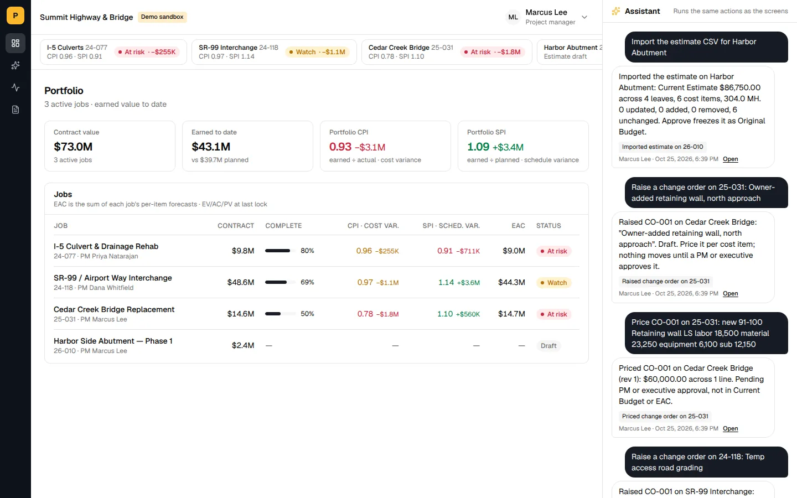
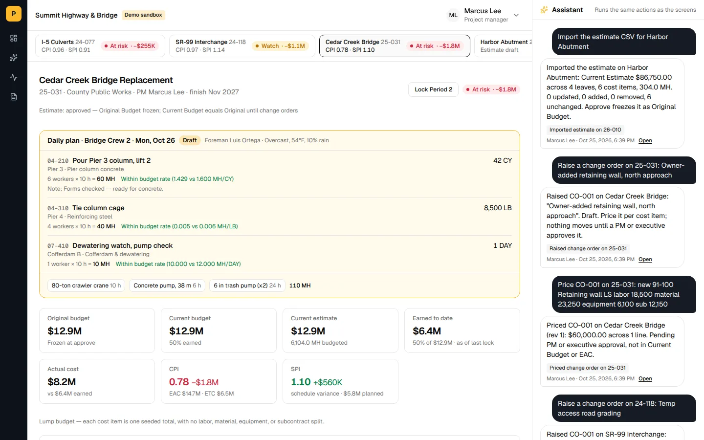
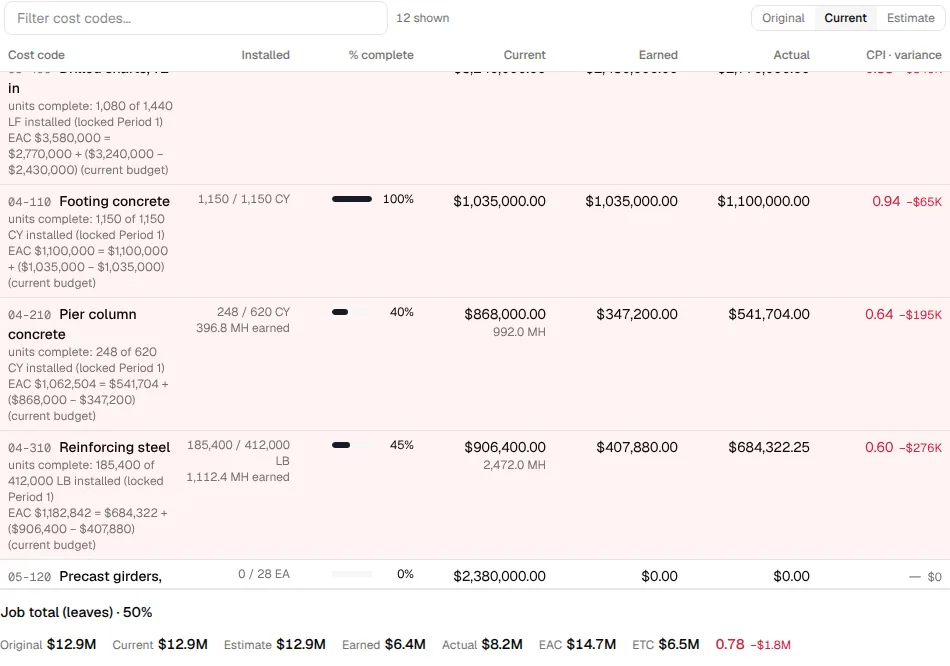
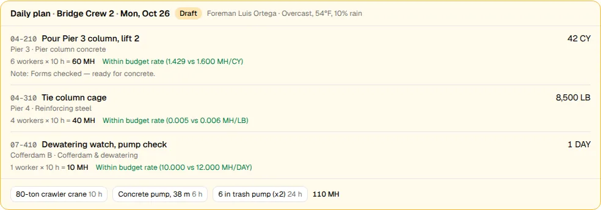
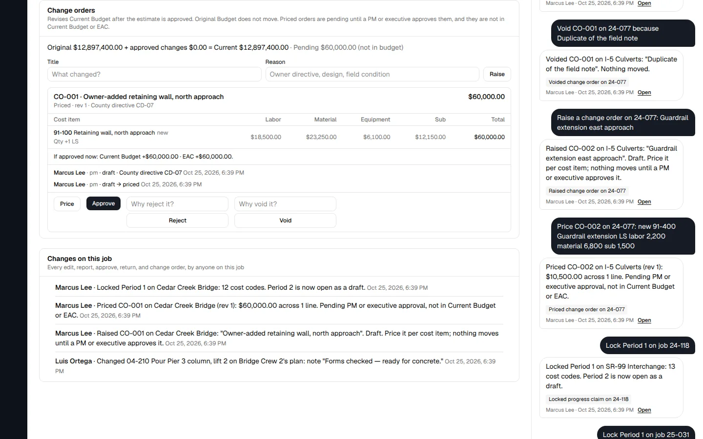
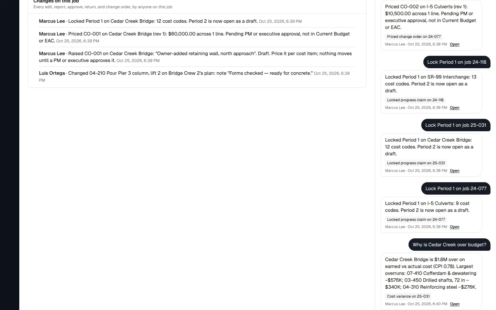

# Pitbull Construction Solutions

[](https://github.com/jgarrison929/pitbull/actions/workflows/ci.yml)
[](https://nextjs.org/)
[](https://www.postgresql.org/)
[](LICENSE)

**Construction project controls** for mid-size heavy-civil and commercial contractors: estimate → budget → field progress → cost and earned value → change orders, on one data model.

**Live demo:** [https://demo.pcserp.app](https://demo.pcserp.app) (Pitbull v5). On the login page, pick a role card (Project Manager, Foreman, Superintendent, Executive) — no signup and no credentials. Each visitor gets a sandbox seeded with Summit Highway & Bridge demo jobs.

| | URL |
|--|-----|
| Demo | https://demo.pcserp.app |
| Same deploy | https://app.pcserp.app |

The active app lives in [`v5/`](v5/README.md) (plan: [`docs/v5/fresh-start-plan.md`](docs/v5/fresh-start-plan.md), roadmap: [`docs/roadmap.md`](docs/roadmap.md)). The legacy modular monolith under `src/` is frozen at tag `legacy-3.8.2-final` and is not what the demo serves.

[Architecture](docs/ARCHITECTURE.md) · [Contributing](CONTRIBUTING.md) · [Vision](VISION.md) · [Security](SECURITY.md) · [Deploy / demo setup](deploy/RAILWAY-DEMO.md)

---

## Product

Pitbull v5 is a single Next.js service with Postgres (Drizzle). The closed loop on the demo:

1. **Portfolio** — contract value, earned, CPI/SPI across jobs  
2. **Job** — daily plan, budget / earned / actual tiles, cost tree  
3. **Cost codes** — installed qty, % complete, earned vs actual, CPI  
4. **Change orders** — raise → price → approve (CO-001 on Cedar Creek 25-031)  
5. **Assistant** — typed actions that match the screens (same writes, same numbers)

| Layer | Technology |
|-------|------------|
| App | Next.js 16, React 19, Tailwind CSS 4, shadcn/ui |
| Data | PostgreSQL 17, Drizzle ORM, per-visitor demo sandboxes |
| Auth | Role cards in demo; JWT + Identity roles in the legacy host |

Persona home layouts and role UX notes: [docs/ROLE-EXPERIENCE.md](docs/ROLE-EXPERIENCE.md).

---

## Screenshots

Captured from the live demo at [demo.pcserp.app](https://demo.pcserp.app) (1440×900, light theme). Regenerate with:

```bash
# from repo root — Playwright comes from v5/node_modules
cd v5 && npm ci && npx playwright install chromium && cd ..
node scripts/capture-readme-screenshots.mjs
```













---

## How this was built

I designed Pitbull's architecture and module boundaries, wrote the specs, and directed AI coding agents to implement them. I don't hand-write the code. My part is the design, the specs, reviewing the work, and deciding what merges.

- **Agent instructions live in the repo.** [`AGENTS.md`](AGENTS.md) covers the stack, version and changelog rules, required reading by task type, and a preflight script to run before pushing. [`CLAUDE.md`](CLAUDE.md) records settled decisions, backend/frontend patterns, a construction-domain glossary, and anti-patterns.
- **Spec before code.** User-facing features get a spec in [`docs/specs/`](docs/specs/) or [`docs/v5/specs/`](docs/v5/specs/) first.
- **Truth over polish.** Agents must label metric proxies honestly and never invent KPIs. In-app AI is assistive only: suggestions can't auto-post progress without an explicit user action.
- **Every PR to `main` runs [CI](.github/workflows/ci.yml)** (`ci-gate`). The v5 job covers lint, typecheck, unit tests, build, and Playwright smoke when `v5/**` changes.

---

## Quick start (v5)

**Prerequisites:** Node.js 24, PostgreSQL 17

```bash
cd v5
nvm use            # see .nvmrc
npm ci
# set DATABASE_URL to a Postgres URL
npm run db:prepare
npm run dev        # http://localhost:3000
```

Checks (same as the v5 CI job): `npm run lint && npm run typecheck && npm test && npm run build && npm run e2e`.

Full runbook: [`v5/README.md`](v5/README.md).

---

## Project structure

```
v5/                            # Active Pitbull app (Next.js + Drizzle)
docs/                          # Architecture, specs, roadmap, screenshots
  images/v5/                   # README screenshots from the live demo
scripts/                       # Capture script, preflight, deploy helpers
src/                           # Legacy 3.8.2 modular monolith (frozen)
tests/                         # Legacy .NET test projects (frozen)
deploy/                        # Railway / production setup
```

---

## Deployment

### Railway

Staging and production run the `v5/` app. See **[deploy/RAILWAY-SETUP.md](deploy/RAILWAY-SETUP.md)** and **[deploy/RAILWAY-DEMO.md](deploy/RAILWAY-DEMO.md)**.

### Self-hosted (legacy compose)

See [docker-compose.prod.yml](docker-compose.prod.yml) and [.env.example](.env.example) for the frozen `src/` stack.

---

## Documentation

- [Docs index](docs/README.md)
- [Live roadmap](docs/roadmap.md)
- [v5 fresh-start plan](docs/v5/fresh-start-plan.md)
- [Agent instructions](AGENTS.md)
- [Contributing](CONTRIBUTING.md)
- [Security policy](SECURITY.md)
- In-app changelog: `v5/src/content/changelog.ts` (legacy Keep a Changelog: [CHANGELOG.md](CHANGELOG.md))
- [Stale docs inventory](docs/stale-docs-inventory.md)

---

## License

[MIT](LICENSE)
